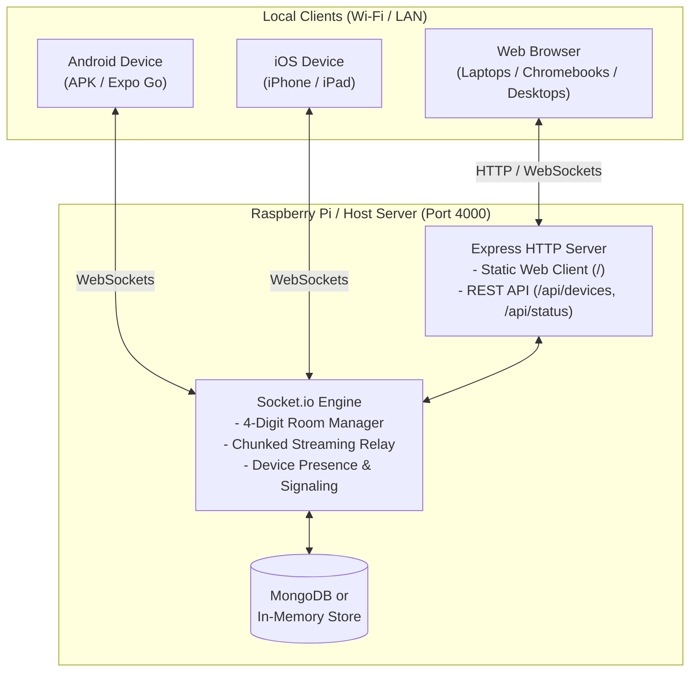

# QuickShare 🚀
### Universal High-Speed LAN File Transfer & Media Relay Platform
*Zero-Cloud • 100% Privacy-First • Air-Gapped Ready • Cross-Platform (Web, Android, iOS, Windows, macOS, Linux)*

QuickShare is a self-hosted, peer-to-peer style local area network (LAN) file, media, video, and text sharing system. It pairs any two devices in seconds using an intuitive **4-digit PIN** or **1-tap local device discovery**, streaming data directly across your local Wi-Fi or Ethernet network without passing through external cloud servers, third-party storage, or paid subscriptions.

Whether deployed on a **Raspberry Pi in a classroom**, a **server in a corporate office**, or a **laptop in a college computer lab**, QuickShare delivers instant cross-platform file transfers for everyone on the local network.

---

## 📑 Table of Contents

- [QuickShare 🚀](#quickshare-)
    - [Universal High-Speed LAN File Transfer & Media Relay Platform](#universal-high-speed-lan-file-transfer--media-relay-platform)
  - [📑 Table of Contents](#-table-of-contents)
  - [✨ Key Features](#-key-features)
  - [🏛️ Architecture Overview](#️-architecture-overview)
  - [🎯 Real-World Deployment Scenarios](#-real-world-deployment-scenarios)
    - [1. 🏫 Schools \& Classrooms (Offline Hotspot Mode)](#1--schools--classrooms-offline-hotspot-mode)
    - [2. 🎓 Colleges \& Universities (Computer Labs \& Campuses)](#2--colleges--universities-computer-labs--campuses)
    - [3. 🏢 Offices \& Workspaces (Air-Gapped \& Corporate Security)](#3--offices--workspaces-air-gapped--corporate-security)
    - [4. 🏠 Homelab \& Personal Use (Universal AirDrop Alternative)](#4--homelab--personal-use-universal-airdrop-alternative)
  - [📂 Project Structure](#-project-structure)
  - [🍓 Raspberry Pi Deployment Guide (Server + Web)](#-raspberry-pi-deployment-guide-server--web)
    - [Prerequisites \& Hardware Requirements](#prerequisites--hardware-requirements)
    - [Step 1: Update OS \& Install Node.js](#step-1-update-os--install-nodejs)
    - [Step 2: Clone Repository \& Install Dependencies](#step-2-clone-repository--install-dependencies)
    - [Step 3: Build the Web Client](#step-3-build-the-web-client)
    - [Step 4: Configure Environment Variables](#step-4-configure-environment-variables)
    - [Step 5: Database Setup (MongoDB vs Zero-Config In-Memory)](#step-5-database-setup-mongodb-vs-zero-config-in-memory)
    - [Step 6: Test Run the Server](#step-6-test-run-the-server)
    - [Step 7: Configure Systemd Daemon (Auto-Start on Boot)](#step-7-configure-systemd-daemon-auto-start-on-boot)
    - [Step 8: Set Up Local Hostname (`quickshare.local` via mDNS)](#step-8-set-up-local-hostname-quicksharelocal-via-mdns)
    - [Step 9: (Optional) Standalone Offline Hotspot Mode](#step-9-optional-standalone-offline-hotspot-mode)
    - [Step 10: (Optional) Nginx Reverse Proxy for Port 80](#step-10-optional-nginx-reverse-proxy-for-port-80)
  - [🌐 Web Client Access (Zero-Install)](#-web-client-access-zero-install)
  - [🤖 Android Client Build \& Deployment](#-android-client-build--deployment)
    - [Option A: Instant Testing via Expo Go (No Build Required)](#option-a-instant-testing-via-expo-go-no-build-required)
    - [Option B: Build Standalone Installable APK (`.apk`) with EAS](#option-b-build-standalone-installable-apk-apk-with-eas)
    - [Option C: Local Native Build with Android Studio](#option-c-local-native-build-with-android-studio)
  - [🍏 iOS Client Build \& Deployment](#-ios-client-build--deployment)
    - [Option A: Instant Testing via Expo Go](#option-a-instant-testing-via-expo-go)
    - [Option B: Build Standalone IPA with EAS Build](#option-b-build-standalone-ipa-with-eas-build)
    - [Option C: Local Build with Xcode (macOS only)](#option-c-local-build-with-xcode-macos-only)
  - [⚙️ Client Server URL Configuration](#️-client-server-url-configuration)
  - [📡 API \& WebSocket Reference](#-api--websocket-reference)
    - [HTTP Endpoints](#http-endpoints)
    - [Socket.io Events](#socketio-events)
  - [🛡️ Firewall \& Network Configuration](#️-firewall--network-configuration)
  - [❓ Troubleshooting \& FAQ](#-troubleshooting--faq)
  - [📄 License](#-license)

---

## ✨ Key Features

- **⚡ Frictionless 4-Digit PIN Pairing**:
  - Sender taps **"Send Files"** to receive a temporary 4-digit code (e.g. `5821`).
  - Receiver enters the code and both devices automatically connect.
- **🔍 Auto-Discovery & 1-Tap Connect**:
  - Devices on the same network discover each other automatically.
  - One tap sends a connection request with accept/reject security dialogs.
- **💾 Hybrid Database Architecture**:
  - Uses **MongoDB** when available to persist device identities, custom names, and pairing history.
  - Automatically falls back to **100% in-memory persistence** if MongoDB is offline or uninstalled. Zero crashes, zero extra configuration required.
- **🚀 High-Throughput Chunked Streaming**:
  - Files are streamed as 48 KB base64 chunks over high-buffer WebSockets (up to 50 MB packet capacity).
  - Real-time progress bars, byte transfer counters, and chunk-acknowledgment integrity verification.
- **📁 Multi-File Selection & Sequential Queue Engine**:
  - Select multiple photos, images, videos, or documents at once from the gallery or file browser.
  - Files are automatically placed into an intelligent transmission queue with immediate visual feedback (`Queued` badges, live progress on active transfer, and dedicated Queue banner).
  - Streamed sequentially without socket congestion, memory bloat, or dropped connections.
- **🌐 Built-in Zero-Install Web Client**:
  - Raspberry Pi / Server serves the exported web client directly from the same port.
  - Users on laptops, Chromebooks, or guest phones simply open their browser to start transferring.
- **📱 Native Mobile Experience (Android & iOS)**:
  - Full support for photo galleries, videos, document pickers, and native OS Share Sheets.
  - In-app video preview player with full playback controls.
  - Native clipboard synchronization and real-time chat/text messaging.
- **🔒 Zero Cloud Dependency & Air-Gapped Ready**:
  - All data stays strictly inside the local network. No external API keys, telemetry, or cloud relays.

---

## 🏛️ Architecture Overview



---

## 🎯 Real-World Deployment Scenarios

### 1. 🏫 Schools & Classrooms (Offline Hotspot Mode)
- **Challenge**: Students often have restricted internet or lack mobile data, while teachers need to distribute worksheets, slides, and collect digital assignments.
- **Solution**: Deploy QuickShare on a **battery-powered Raspberry Pi** running in standalone Wi-Fi Access Point mode. No internet or SIM card needed.
- **Benefits**:
  - Distraction-free (students cannot browse the web).
  - Works anywhere: field trips, buses, rural schools, or power-outage environments.
  - Teachers broadcast study materials; students submit homework directly.

### 2. 🎓 Colleges & Universities (Computer Labs & Campuses)
- **Challenge**: Campus Wi-Fi often throttles cloud storage (Google Drive, WeTransfer, OneDrive), making it painful to transfer large programming projects, VM images, dataset archives, or high-res video edits.
- **Solution**: Place a Raspberry Pi on the campus or department subnet with a static IP or `quickshare.local`.
- **Benefits**:
  - Ultra-fast LAN speeds (up to 1000 Mbps over Ethernet or Wi-Fi 5/6).
  - No file size quotas or upload caps.
  - Works seamlessly across student MacBooks, Windows PCs, Linux workstations, Android phones, and iPhones.

### 3. 🏢 Offices & Workspaces (Air-Gapped & Corporate Security)
- **Challenge**: Corporate security policies prohibit uploading confidential documents, legal contracts, or intellectual property to third-party cloud services.
- **Solution**: Run QuickShare on an internal office server or dedicated Raspberry Pi behind the corporate firewall.
- **Benefits**:
  - Complete data sovereignty — zero bits leave the building.
  - Instant pairing during meeting room presentations without cables or USB flash drives.
  - Compatible with strict corporate guest networks.

### 4. 🏠 Homelab & Personal Use (Universal AirDrop Alternative)
- **Challenge**: Apple AirDrop does not work with Windows, Linux, or Android.
- **Solution**: Keep QuickShare running 24/7 on a Raspberry Pi or home server.
- **Benefits**:
  - Send photos, clips, and APK files between any phone and PC in seconds.
  - Accessible via any web browser at `http://quickshare.local:4000`.

---

## 📂 Project Structure

```
iamdone/
├── server/                        # Node.js + Express + Socket.io Server
│   ├── index.js                  # Main server, room lifecycle & static web hosting
│   ├── package.json              # Server dependencies & scripts
│   ├── models/
│   │   └── Device.js             # Mongoose schema for persistent device registry
│   ├── .env                      # Active environment configuration
│   └── .env.example              # Environment variables template
│
├── client/                       # React Native / Expo Universal Client
│   ├── App.js                    # Root component, routing & modals
│   ├── app.json                  # Expo configuration & native permissions
│   ├── eas.json                  # EAS Build configuration for APK & IPA
│   ├── package.json              # Client dependencies & scripts
│   ├── dist/                     # Pre-built static web bundle (served by server)
│   └── src/
│       ├── components/
│       │   ├── Header.js                  # Status badge & disconnect control
│       │   ├── PinCodeDisplay.js          # Large 4-digit sender PIN display
│       │   ├── PinCodeInput.js            # Auto-advancing 4-digit input keypad
│       │   ├── TransferCard.js            # Progress bar, speed & save/share buttons
│       │   ├── VideoPlayerModal.js        # Built-in native video preview player
│       │   ├── ServerUrlModal.js          # Server IP address configuration
│       │   ├── EditDeviceNameModal.js     # Custom device moniker modal
│       │   └── IncomingConnectionModal.js # Direct 1-tap request prompt
│       ├── screens/
│       │   ├── HomeScreen.js              # Discovery dashboard & mode selection
│       │   ├── SenderScreen.js            # 4-digit PIN waiting screen
│       │   ├── ReceiverScreen.js          # PIN entry screen
│       │   └── TransferScreen.js          # Active transfers & chat hub
│       └── services/
│           ├── socketService.js           # Socket.io connection & events
│           ├── deviceService.js           # Identity & persistent storage
│           └── fileTransferService.js     # Chunking engine, base64 streamer & assembler
│
└── README.md                     # Comprehensive deployment & usage manual
```

---

## 🍓 Raspberry Pi Deployment Guide (Server + Web)

Follow this guide to deploy QuickShare on any Raspberry Pi (Raspberry Pi 3B, 3B+, 4B, 5, or Zero 2 W) running **Raspberry Pi OS** (32-bit or 64-bit).

### Prerequisites & Hardware Requirements
- **Raspberry Pi** with Raspberry Pi OS installed and network access (Wi-Fi or Ethernet).
- **Power Supply** matching your Pi model (e.g., 5V/3A USB-C for Pi 4, 5V/5A for Pi 5).
- **SSH access** or terminal access via keyboard/monitor.

---

### Step 1: Update OS & Install Node.js

SSH into your Raspberry Pi:
```bash
ssh pi@<raspberry-pi-ip>
```

Update package lists and system packages:
```bash
sudo apt update && sudo apt upgrade -y
sudo apt install -y git curl ufw avahi-daemon
```

Install **Node.js 20 LTS** (recommended):
```bash
curl -fsSL https://deb.nodesource.com/setup_20.x | sudo -E bash -
sudo apt install -y nodejs

# Verify installation
node -v   # Should output v20.x.x
npm -v    # Should output v10.x.x
```

---

### Step 2: Clone Repository & Install Dependencies

Clone the project to the home directory:
```bash
cd ~
git clone https://github.com/your-username/iamdone.git
cd iamdone
```

Install server dependencies:
```bash
cd ~/iamdone/server
npm install
```

Install client dependencies:
```bash
cd ~/iamdone/client
npm install
```

---

### Step 3: Build the Web Client

QuickShare compiles the React Native app into a production-grade static web application that the Node.js server serves automatically.

Build the web distribution on your Pi:
```bash
cd ~/iamdone/client
npm run build:web
```
> **Tip**: If building on a low-memory Raspberry Pi (such as Pi Zero 2 W or 1GB Pi 3), run `npm run build:web` on your primary computer first and commit/copy the `client/dist` folder to the Pi.

Verify that `~/iamdone/client/dist` exists with `index.html`.

---

### Step 4: Configure Environment Variables

Create the `.env` file in the server directory:
```bash
cd ~/iamdone/server
cp .env.example .env
nano .env
```

Ensure your configuration matches your preferences:
```env
# Port on which QuickShare listens (Default: 4000)
PORT=4000

# MongoDB URI (Leave default if using local MongoDB, or comment out for in-memory mode)
MONGODB_URI=mongodb://127.0.0.1:27017/quickshare
```

Save and exit (`Ctrl + O`, `Enter`, `Ctrl + X`).

---

### Step 5: Database Setup (MongoDB vs Zero-Config In-Memory)

QuickShare features a **dual-engine persistence layer**:

#### Option A: Zero-Config In-Memory Mode (Recommended for quick setups)
- **You do NOT need to install MongoDB!**
- If MongoDB is absent, QuickShare automatically runs in memory.
- All pairing, 4-digit codes, chunk relays, text messaging, and active device discovery function 100% normally.
- Device pairings stay active for the entire server uptime.

#### Option B: Persistent MongoDB Database
If you want device identities, permanent PINs, and pairing history to persist across server reboots:

Install MongoDB on Raspberry Pi OS 64-bit:
```bash
# On 64-bit Debian/Raspberry Pi OS:
sudo apt install -y mongodb-server
sudo systemctl enable --now mongodb
```
Or run MongoDB via Docker:
```bash
sudo apt install -y docker.io
sudo docker run -d --name quickshare-mongo -p 27017:27017 -v mongo_data:/data/db --restart always mongo:latest
```

---

### Step 6: Test Run the Server

Start the server manually to verify:
```bash
cd ~/iamdone/server
npm start
```

You should see output similar to:
```
======================================================
🚀 QuickShare Signaling & Relay Server is LIVE on port 4000
📦 Serving Web Client static files from: /home/pi/iamdone/client/dist
📡 Localhost:     http://localhost:4000
📱 On your Mobile Phone, enter this Server URL:
   👉 http://192.168.1.150:4000
======================================================
```

Open a web browser on another computer or phone connected to the same Wi-Fi and navigate to:
`http://<raspberry-pi-ip>:4000`

If the QuickShare web app loads, your setup is working! Press `Ctrl + C` in the terminal to stop the manual process.

---

### Step 7: Configure Systemd Daemon (Auto-Start on Boot)

To ensure QuickShare runs 24/7 as a background service and survives system restarts, create a systemd service unit:

```bash
sudo nano /etc/systemd/system/quickshare.service
```

Paste the following configuration (replace `pi` with your username if different):
```ini
[Unit]
Description=QuickShare File Transfer Relay Server
After=network.target

[Service]
Type=simple
User=pi
WorkingDirectory=/home/pi/iamdone/server
ExecStart=/usr/bin/node index.js
Restart=always
RestartSec=5
Environment=NODE_ENV=production
Environment=PORT=4000

# Security sandboxing
NoNewPrivileges=true

[Install]
WantedBy=multi-user.target
```

Reload systemd, enable the service, and start it:
```bash
sudo systemctl daemon-reload
sudo systemctl enable quickshare
sudo systemctl start quickshare
```

Check service status:
```bash
sudo systemctl status quickshare
```

View real-time server logs anytime:
```bash
journalctl -u quickshare -f
```

---

### Step 8: Set Up Local Hostname (`quickshare.local` via mDNS)

Make accessing QuickShare effortless so users do not need to memorize IP addresses.

Install and enable Avahi (mDNS):
```bash
sudo apt install -y avahi-daemon
sudo systemctl enable --now avahi-daemon
```

Set the Raspberry Pi hostname to `quickshare`:
```bash
sudo hostnamectl set-hostname quickshare
```

Update `/etc/hosts`:
```bash
sudo nano /etc/hosts
```
Change the `127.0.1.1` entry to:
```
127.0.1.1       quickshare
```

Now, anyone on the network can access the server using:
`http://quickshare.local:4000`

---

### Step 9: (Optional) Standalone Offline Hotspot Mode

For **schools, classrooms, field research, or disaster relief**, you can configure the Raspberry Pi to broadcast its own Wi-Fi network without requiring an upstream internet connection.

#### Using NetworkManager (Raspberry Pi OS Bookworm):
```bash
# Create hotspot named "QuickShare-WiFi" with password "quickshare123"
sudo nmcli dev wifi hotspot ifname wlan0 ssid "QuickShare-WiFi" password "quickshare123"

# Set static IP for the Pi on the hotspot
sudo nmcli connection modify Hotspot ipv4.addresses 192.168.4.1/24
sudo nmcli connection modify Hotspot ipv4.method shared
sudo nmcli connection up Hotspot
```

Now, students or coworkers connect their phones and laptops to `QuickShare-WiFi` and navigate directly to:
`http://192.168.4.1:4000`

No internet data consumed, 100% private and portable!

---

### Step 10: (Optional) Nginx Reverse Proxy for Port 80

If you want users to access QuickShare on standard port `80` (so they don't need to type `:4000`):

```bash
sudo apt install -y nginx
sudo nano /etc/nginx/sites-available/quickshare
```

Paste the following Nginx configuration:
```nginx
server {
    listen 80;
    server_name quickshare.local;

    # Maximum upload body size for chunk buffers
    client_max_body_size 100M;

    location / {
        proxy_pass http://127.0.0.1:4000;
        proxy_http_version 1.1;

        # WebSocket support
        proxy_set_header Upgrade $http_upgrade;
        proxy_set_header Connection "upgrade";
        proxy_set_header Host $host;

        proxy_set_header X-Real-IP $remote_addr;
        proxy_set_header X-Forwarded-For $proxy_add_x_forwarded_for;
        proxy_read_timeout 86400s;
        proxy_send_timeout 86400s;
    }
}
```

Enable the site and reload Nginx:
```bash
sudo ln -s /etc/nginx/sites-available/quickshare /etc/nginx/sites-enabled/
sudo rm -f /etc/nginx/sites-enabled/default
sudo nginx -t
sudo systemctl reload nginx
```

Users can now simply visit `http://quickshare.local` or `http://<pi-ip>` in their browser!

---

## 🌐 Web Client Access (Zero-Install)

The Web Client works instantly on any modern browser (**Google Chrome, Apple Safari, Mozilla Firefox, Microsoft Edge, Brave, Opera**).

1. Connect to the same Wi-Fi or Ethernet network as the Raspberry Pi.
2. Open your browser and navigate to:
   ```
   http://quickshare.local:4000   (or http://<raspberry-pi-ip>:4000)
   ```
3. The browser automatically connects to the server and assigns your device a name (e.g. `Windows PC`, `MacBook`, or `Linux Machine`).
4. **To Send Files**:
   - Tap **"Send Files"**.
   - Note the 4-digit PIN (e.g., `3892`).
   - Drag & drop or pick files, photos, or documents.
5. **To Receive Files**:
   - Tap **"Receive Files"**.
   - Enter the 4-digit PIN.
   - Incoming files download automatically to your browser's default `Downloads` folder.

---

## 🤖 Android Client Build & Deployment

You have three flexible ways to run and build QuickShare for Android:

### Option A: Instant Testing via Expo Go (No Build Required)
1. Install **Expo Go** from the [Google Play Store](https://play.google.com/store/apps/details?id=host.exp.exponent).
2. On your development machine:
   ```bash
   cd iamdone/client
   npx expo start
   ```
3. Open Expo Go on your phone and tap **"Scan QR code"**. Scan the barcode printed in your terminal.
4. Tap the **Server URL pill** on top of the screen (or the gear icon) and type your Raspberry Pi address:
   `http://192.168.1.150:4000`

---

### Option B: Build Standalone Installable APK (`.apk`) with EAS
This method builds an installable `.apk` file that can be distributed to students, colleagues, or downloaded from a webpage without Google Play.

1. Install EAS CLI globally:
   ```bash
   npm install -g eas-cli
   ```
2. Log into your free Expo account (or create one at [expo.dev](https://expo.dev)):
   ```bash
   eas login
   ```
3. Build the standalone APK:
   ```bash
   cd iamdone/client
   eas build -p android --profile preview
   ```
4. Once the cloud build completes, EAS provides a direct download link for the `.apk` file.
5. Sideload the APK onto any Android phone (enable "Install unknown apps" when prompted).
6. *(Optional)* Host the `.apk` directly on your Raspberry Pi so anyone on the local Wi-Fi can download it:
   ```bash
   cp /path/to/quickshare.apk ~/iamdone/client/dist/quickshare.apk
   ```
   Users can then download the app from `http://quickshare.local:4000/quickshare.apk`.

---

### Option C: Local Native Build with Android Studio
If you prefer building locally without EAS cloud servers:
1. Ensure Android Studio and Android SDK are installed with `ANDROID_HOME` configured.
2. Generate the native android project:
   ```bash
   cd iamdone/client
   npx expo run:android
   ```
3. The APK will be built and launched on your connected USB Android device or emulator.

---

## 🍏 iOS Client Build & Deployment

### Option A: Instant Testing via Expo Go
1. Install **Expo Go** from the [Apple App Store](https://apps.apple.com/app/expo-go/id982107779).
2. On your computer:
   ```bash
   cd iamdone/client
   npx expo start
   ```
3. Open the iOS **Camera** app, point it at the terminal QR code, and tap the prompt to open in Expo Go.
4. Tap the **Server URL** indicator and enter your Raspberry Pi server address (e.g. `http://192.168.1.150:4000`).

---

### Option B: Build Standalone IPA with EAS Build
To create a standalone iOS app for internal distribution or Apple TestFlight:

1. Configure EAS login:
   ```bash
   cd iamdone/client
   eas login
   ```
2. Build for iOS internal distribution / Ad-Hoc / TestFlight:
   ```bash
   eas build -p ios --profile preview
   ```
   *(Note: Apple requires an active Apple Developer Program account for signing standalone iOS builds).*

---

### Option C: Local Build with Xcode (macOS only)
1. Ensure Xcode and CocoaPods are installed on macOS.
2. Run the native build command:
   ```bash
   cd iamdone/client
   npx expo run:ios
   ```

---

## ⚙️ Client Server URL Configuration

When running the Android or iOS native app, the device needs to know your Raspberry Pi server's IP address:

1. Launch QuickShare on your phone.
2. Look at the top right of the home screen:
   - If connected, it displays a green **"Connected"** badge.
   - If disconnected, tap the **Server URL pill** or tap the gear settings icon.
3. Enter your Raspberry Pi's local IP address and port:
   ```
   http://192.168.1.150:4000
   ```
   *(Or `http://quickshare.local:4000` on devices that support mDNS).*
4. Tap **"Save & Connect"**. The app immediately verifies the connection and loads all active nearby peers!

---

## 📡 API & WebSocket Reference

### HTTP Endpoints

| Method | Endpoint | Description |
| :--- | :--- | :--- |
| `GET` | `/` | Serves the Web Client application (or JSON status if web dist not built) |
| `GET` | `/api/status` | Real-time health check, MongoDB connection state, active rooms & devices |
| `GET` | `/api/devices` | Returns list of all registered devices |
| `POST` | `/api/devices/register` | Registers device profile, nickname, and permanent 4-digit code |

#### Sample `/api/status` Response:
```json
{
  "status": "online",
  "message": "QuickShare Relay Server is active",
  "database": "in-memory (MongoDB offline)",
  "activeRooms": 2,
  "totalDevices": 4,
  "onlineDevices": 3,
  "webClientAvailable": true,
  "timestamp": "2026-11-07T10:45:00.000Z"
}
```

---

### Socket.io Events

| Event Name | Direction | Payload | Description |
| :--- | :--- | :--- | :--- |
| `register-device` | Client ➔ Server | `{ deviceId, deviceName }` | Registers device profile on socket connection |
| `create-room` | Client ➔ Server | `{ senderName }` | Generates a 4-digit room code for file sharing |
| `join-room` | Client ➔ Server | `{ roomCode, receiverName }` | Receiver joins active room by 4-digit code |
| `direct-connect-request` | Client ➔ Server | `{ targetDeviceId, requesterProfile }` | Initiates 1-tap direct connection to a peer |
| `chunk-transfer` | Client ➔ Server ➔ Peer | `{ roomCode, id, chunk, index, total }` | Streams 48 KB base64 slice of file payload |
| `chunk-ack` | Client ➔ Server ➔ Peer | `{ roomCode, id, index }` | Acknowledges receipt of chunk index |
| `transfer-complete` | Client ➔ Server ➔ Peer | `{ roomCode, id, name, size, mimeType }` | Signals file transfer has finished |
| `send-message` | Client ➔ Server ➔ Peer | `{ roomCode, text }` | Relays real-time chat/text message in room |

---

## 🛡️ Firewall & Network Configuration

If devices or standalone APK builds cannot connect to the server:

### 1. Android Standalone APK (Cleartext HTTP Policy)
Starting with Android 9 (API 28+), Android blocks all non-HTTPS (cleartext HTTP) traffic by default in standalone release APKs.
QuickShare includes this in `client/app.json`:
```json
"android": {
  "usesCleartextTraffic": true
}
```
This enables the Android APK to communicate with local IP addresses (`http://192.168.X.X:4000`) over your local Wi-Fi.

### 2. Allow Port 4000 in Ubuntu/Debian / Raspberry Pi Firewall (UFW)
```bash
sudo ufw allow 4000/tcp comment "QuickShare Server"
sudo ufw reload
```

### 3. Allow Port 4000 in Windows Firewall (if running server on PC)
If your relay server runs on Windows, Windows Defender Firewall blocks inbound traffic on port 4000 by default:
```powershell
New-NetFirewallRule -DisplayName "QuickShare Port 4000" -Direction Inbound -LocalPort 4000 -Protocol TCP -Action Allow
```

### 4. Disable "AP Isolation" / "Client Isolation" on Router
Some school, university, or office Wi-Fi routers enable **AP Isolation** (or Client Isolation). When enabled, wireless devices cannot communicate directly with other devices on the same Wi-Fi.
- Log into your Wi-Fi router admin page.
- Navigate to **Wireless Settings** ➔ **Advanced**.
- Ensure **AP Isolation / Client Isolation / Guest Mode Isolation** is turned **OFF**.

### 5. Verify Server Reachability
From your computer or phone browser, test if the server responds:
```bash
curl http://<server-ip>:4000/api/status
```
*(Or use the built-in **"Test Connection"** button inside the app's Server URL Settings modal).*

---

## ❓ Troubleshooting & FAQ

<details>
<summary><b>1. The standalone APK says "Disconnected" or cannot reach server IP</b></summary>

- **"localhost" points to the phone**: When using a physical phone, `localhost` (127.0.0.1) refers to the phone itself, not your server. In the app, tap the **Server URL pill** or gear icon and enter your computer or Raspberry Pi's actual LAN IP address: `http://192.168.1.X:4000`.
- **Use the in-app "Test Connection" button**: Tap "Test Connection" inside the Server URL modal to verify reachability.
- **Cleartext Traffic Policy**: Ensure `"usesCleartextTraffic": true` is present under `"android"` in `app.json` before building the APK (already pre-configured in this repository).
- **Same Wi-Fi Network**: Ensure your phone and server are connected to the same Wi-Fi network (and not on mobile data).
- **Host Firewall**: If running on Windows, make sure Windows Firewall allows TCP port 4000. On Linux, run `sudo ufw allow 4000/tcp`.
</details>

<details>
<summary><b>2. Do I need to install MongoDB?</b></summary>

- **No.** QuickShare runs out of the box with zero external databases. It includes an automatic in-memory fallback engine. MongoDB is only needed if you want device identities and pairing logs to persist across server reboots.
</details>

<details>
<summary><b>3. How do received files open on iOS and Android?</b></summary>

- QuickShare uses native OS MIME resolution and the native **Share Sheet** (`expo-sharing`). When a file finishes transferring:
  - **Photos & Videos**: Tap **"Open or Share File"** to save to Camera Roll, Photo Gallery, or play in your media player.
  - **PDFs & Documents**: Tap to open in Google Drive, Files app, Acrobat, or send via WhatsApp/Slack.
  - **Web Client**: Files trigger an instant browser download directly to your default `Downloads` directory.
</details>

<details>
<summary><b>4. How fast are file transfers?</b></summary>

- Transfer speeds depend entirely on your local Wi-Fi or Ethernet router.
- On a standard Wi-Fi 5 (802.11ac) or Wi-Fi 6 router, transfers typically reach **15 MB/s to 45 MB/s** (120 Mbps – 360 Mbps), transferring a 1 GB video in under 30 seconds.
</details>

<details>
<summary><b>5. Can I use QuickShare without an internet connection?</b></summary>

- **Yes!** QuickShare requires zero internet connectivity. As long as devices are connected to the same local Wi-Fi router, an Ethernet switch, or the Raspberry Pi's standalone hotspot (see [Step 9](#step-9-optional-standalone-offline-hotspot-mode)), transfers will work seamlessly.
</details>

---

## 📄 License

This project is licensed under the MIT License — see the [LICENSE](client/LICENSE) file for details.
